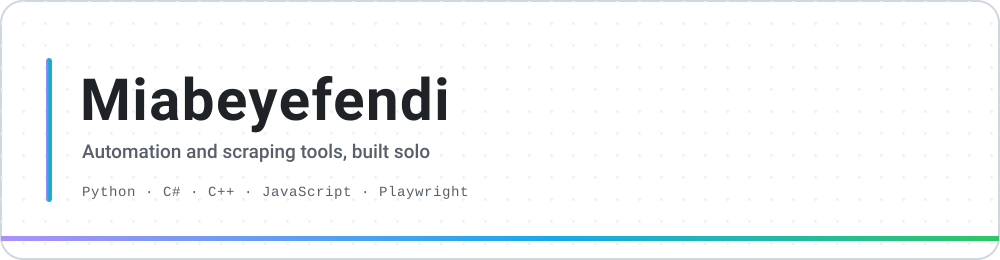
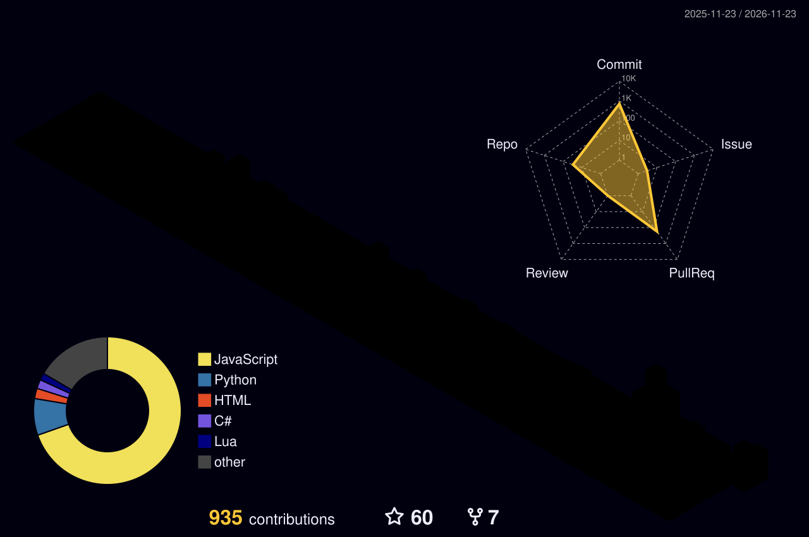

<picture>
  <source media="(prefers-color-scheme: dark)" srcset="./assets/banner-dark.svg">
  
</picture>

  

---

### I take a platform apart, then build the tool I wanted while I was inside it.

Thirteen of them so far. A Spotify theme in two editions, a Steam client replacement 
that never opens Steam, two maps for The Blood of Dawnwalker, two Squad server mods, 
and a shelf of automation tools that all obey the same two rules: 
**never faster than a person**, and **never ask for a password**.

---

<picture>
  <source media="(prefers-color-scheme: dark)" srcset="./assets/s-build-dark.svg">
  
</picture>

 

<table>
<tr><td>🎨 <b><a href="https://github.com/Miabeyefendi/Vantagraph">Vantagraph</a></b></td><td>Spicetify theme: 11 palettes, settings panel, 66 icons, lyric karaoke</td></tr>
<tr><td>🖌️ <b><a href="https://github.com/Miabeyefendi/Vantagraph-Custom">Vantagraph-Custom</a></b></td><td>The lite edition. 36 colours from an in-app editor, shareable palettes</td></tr>
<tr><td>🎮 <b><a href="https://github.com/Miabeyefendi/SteamEdge">SteamEdge</a></b></td><td>Farms cards, banks playtime, writes achievements. Steam never opens</td></tr>
<tr><td>🗺️ <b><a href="https://github.com/Miabeyefendi/ValeSangora-InGameMap">ValeSangora-InGameMap</a></b></td><td>1816 markers on Dawnwalker's own map. A UE4SS Lua mod</td></tr>
<tr><td>🧭 <b><a href="https://github.com/Miabeyefendi/ValeSangora-LiveMap">ValeSangora-LiveMap</a></b></td><td>Live overlay map on Alt+CapsLock. Follows you, marks what you clear</td></tr>
<tr><td>🔀 <b><a href="https://github.com/Miabeyefendi/Squad-SmartShuffle">Squad-SmartShuffle</a></b></td><td>SquadJS plugin that rebalances teams from each match's stats</td></tr>
<tr><td>🎙️ <b><a href="https://github.com/Miabeyefendi/Squad-VoteTalkLimit">Squad-VoteTalkLimit</a></b></td><td>Experimental talk-time cap for end-of-match votes. Untested</td></tr>
<tr><td>🎬 <b><a href="https://github.com/Miabeyefendi/Letterboxd-Munfollow">Letterboxd-Munfollow</a></b></td><td>Finds who never followed back. Unfollow, block or unblock in bulk</td></tr>
<tr><td>🎬 <b><a href="https://github.com/Miabeyefendi/Letterboxd-Masfollow">Letterboxd-Masfollow</a></b></td><td>The other direction. Targets real accounts, skips the dead ones</td></tr>
<tr><td>📨 <b><a href="https://github.com/Miabeyefendi/IG-DMKeep">IG-DMKeep</a></b></td><td>Saves your Instagram conversations, media included, in the browser</td></tr>
<tr><td>📸 <b><a href="https://github.com/Miabeyefendi/IG-Munfollow">IG-Munfollow</a></b></td><td>Seven filters over your following list, then bulk unfollow</td></tr>
<tr><td>🐍 <b><a href="https://github.com/Miabeyefendi/IG-Munliker">IG-Munliker</a></b></td><td>Clears the like history while behaving like a phone, not a loop</td></tr>
<tr><td>🧠 <b><a href="https://github.com/Miabeyefendi/LLM-Prompt-Collection">LLM-Prompt-Collection</a></b></td><td>63 prompts in eleven categories, kept as plain text</td></tr>
</table>

Every one of them is documented in <b>English · Türkçe · Español · 简体中文 · Русский</b>, except the live map, which is English only

---

 

 

<i>If it can be automated, it should be. Slowly.</i>

